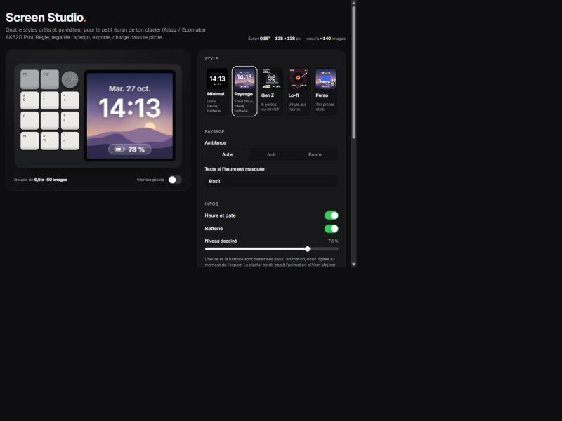

<div align="center">

# Screen Studio

**Make the tiny screen on your mechanical keyboard look good.**

Ready-made animated styles and a drag-and-drop layer editor for the 128 × 128 TFT screen of the **Ajazz / Epomaker AK820 Pro**. Runs in the browser. Free and open source.

[](https://github.com/forcela/keyboard-screen-studio/actions/workflows/pages.yml)
[](LICENSE)

[**Open Screen Studio →**](https://forcela.github.io/keyboard-screen-studio/)

[English](#english) · [Français](#français)



</div>

---

## English

### What it does

The AK820 Pro ships with a small 0.85" color screen (128 × 128 px) and a stock display most people find bland. The official driver lets you upload your own animation, but you have to bring the frames yourself. Screen Studio makes those frames.

- **4 ready-made styles**
  - **Minimal**: date, big time, battery. Nothing else.
  - **Landscape**: soft wallpaper (dawn, night or mist) with drifting fog, the time and a glass battery pill.
  - **Gen Z**: five pixel mascots (cat typing, sleeping cat, cat with sunglasses, ghost, frog) on neutral palettes, or your own GIF.
  - **Lo-fi**: spinning vinyl record with a scrolling title.
- **Custom style editor**
  - Layers: background, effects (stars, snow, sparkles, grid, mist), time, date, battery, text, shapes, image or GIF, pixel mascots.
  - Drag layers on the live preview, resize from the corner, nudge with the arrow keys, snap to center, duplicate with Ctrl + D.
  - Per-layer settings: font, weight, size, color, soft shadow, opacity, battery style (pill, icon, ring, bar), corner radius, outline.
  - Per-layer animation that loops seamlessly: float, pulse, blink, sway, spin.
  - Start from a template (and undo it), auto-save in the browser, save and open styles as `.json`.
- **Export** every frame as a PNG in a `.zip`, ready for the official driver.
- Nothing to install, no account, no tracking. Everything runs locally in your browser.

The interface is in French for now. Translations are welcome, see [CONTRIBUTING.md](CONTRIBUTING.md).

### Put the animation on your keyboard

1. In Screen Studio, pick or build a style and click **Exporter les images (.zip)**. Unzip it: you get `frame_000.png`, `frame_001.png`, …
2. Install the official **AK820 Pro driver** (Windows) from [Epomaker](https://epomaker.com/blogs/software/ajazz-ak820-pro-driver).
3. Connect the keyboard **with the USB cable** and set its switch to **wired mode**. The screen tab does not show up over 2.4 GHz or Bluetooth.
4. In the driver, open the **TFT** tab, click **New**, then **+**, select **all the frames at once**, confirm and upload.
5. **Fn + Delete** switches the screen between the stock clock and your animation.

Black screen after upload? Try again with fewer frames (24 to 48).

### Limits worth knowing

- **No live data.** The keyboard stores the animation and plays it in a loop. The PC cannot push live content, so the time and battery drawn in a style are frozen at export time. For the real time, use the keyboard's own clock page (set with **TFT → Time Sync** in the driver). Caps Lock and connection state are only shown on that page, for the same reason.
- About 140 frames max, 2 to 510 ms per frame (community findings, not an official spec).
- GIF import uses the browser's `ImageDecoder` (tested in Chromium browsers). Where it is missing, a GIF loads as a still image.

### Develop

Angular 22, TypeScript (strict), Tailwind CSS 4, Vitest. Package manager: pnpm.

```bash
git clone https://github.com/forcela/keyboard-screen-studio.git
cd keyboard-screen-studio
pnpm install
pnpm start          # http://localhost:4200
```

| Command | What it does |
| --- | --- |
| `pnpm start` | Dev server with live reload |
| `pnpm test` | Unit tests with coverage (fails under 70 % lines in `core`) |
| `pnpm lint` | ESLint, Angular rules |
| `pnpm build` | Production build in `dist/screen-studio/browser` |
| `pnpm check` | Tests, lint and build, as the CI runs them |

Every push to `main` is tested and deployed to GitHub Pages by [`.github/workflows/pages.yml`](.github/workflows/pages.yml). In the repository settings, set **Pages → Source** to **GitHub Actions** once.

### Project structure

```
src/app/
  core/                 no UI here
    render/             pure drawing code, no Angular: canvas helpers, sprites, scenery,
                        effects, battery widget, layer model and renderer, one file per style
    state/              signal stores: StudioStore (style, loop) and EditorStore (layers)
    rendering/          one shared animation clock and the frame renderer
    export/             PNG and zip export
    media/              GIF and image decoding
    style-file/         save and load styles as JSON, validating untrusted input
  features/
    stage/              keyboard mock-up, live preview, selection on the preview
    settings/           style picker, per-style settings, info, export
    editor/             templates, layer list, layer settings, style files
    help/               install steps
  shared/
    ui/                 small reusable components (segmented control, switch, range, color…)
    utils/
src/testing/            test helpers (a recording canvas context)
```

The rendering code in `core/render` takes a canvas context and a time `t` in [0, 1) and draws one frame. It knows nothing about Angular, so it can be tested and reused anywhere.

### Style file format

A saved style is JSON. Layers are drawn in order, the first one at the back. `x` and `y` are the layer's center in screen pixels. Images are embedded as data URLs.

```json
{
  "app": "screen-studio",
  "version": 1,
  "width": 128,
  "height": 128,
  "frames": 48,
  "delay": 80,
  "layers": [
    { "type": "background", "visible": true, "mode": "scenery", "ambiance": "dawn" },
    { "type": "time", "visible": true, "x": 64, "y": 52, "size": 38, "font": "inter", "weight": 600, "color": "#ffffff", "animation": "none" },
    { "type": "battery", "visible": true, "x": 64, "y": 113, "style": "pill", "color": "#ffffff", "scale": 1 }
  ]
}
```

Fields that are missing take their default. Unknown types and values are dropped, so a hand-edited file can not break the page.

### Roadmap

- [ ] Upload straight to the keyboard over USB from the browser (WebHID), without the official driver
- [ ] English interface
- [ ] Other screen sizes and other keyboards with a TFT screen
- [ ] Animated GIF export
- [ ] Style gallery shared by the community

Ideas and pull requests are welcome, see [CONTRIBUTING.md](CONTRIBUTING.md).

### Credits

The screen specs (128 × 128, RGB565, frame limits) come from community projects that reverse-engineered the keyboard:
[open-ak820-pro](https://github.com/anthonymolinam/open-ak820-pro),
[ak820-linux](https://github.com/hcristosm/ak820-linux),
[ak820pro-modder](https://github.com/wsclx/ak820pro-modder),
[ajazzctl](https://github.com/SpawW/ajazzctl).

Screen Studio is an independent project. It is not affiliated with or endorsed by Ajazz or Epomaker.

---

## Français

### C'est quoi ?

Le clavier **Ajazz / Epomaker AK820 Pro** a un petit écran couleur de 0,85" (128 × 128 px) dont l'affichage d'origine est assez triste. Le pilote officiel permet d'y mettre ta propre animation, mais il faut lui fournir les images. Screen Studio les fabrique pour toi, directement dans le navigateur.

- **4 styles prêts** : Minimal, Paysage, Gen Z (5 persos pixel ou ton GIF), Lo-fi.
- **Un éditeur Perso** : ajoute des calques (heure, date, batterie, texte, forme, image ou GIF, perso, effets), déplace-les à la souris, règle-les, anime-les, enregistre ton style en `.json`.
- **Export** de toutes les images en `.zip`, prêtes pour le pilote.
- Rien à installer, pas de compte, rien n'est envoyé nulle part.

### Mettre l'animation sur le clavier

1. Exporte le `.zip` depuis Screen Studio et décompresse-le.
2. Installe le pilote **AK820 Pro** (Windows) depuis [Epomaker](https://epomaker.com/blogs/software/ajazz-ak820-pro-driver).
3. Branche le clavier **en câble USB**, interrupteur en **mode filaire**.
4. Dans le pilote : onglet **TFT** → **New** → **+** → sélectionne **toutes les images d'un coup** → valide et envoie.
5. **Fn + Suppr** bascule entre l'horloge d'origine et ton animation.

L'heure et la batterie dessinées dans l'animation sont figées au moment de l'export : le clavier ne reçoit pas de données en direct.

### Développer

```bash
pnpm install
pnpm start
```

Voir la section [Develop](#develop) pour les commandes et la structure du projet.

---

## License

[MIT](LICENSE) © 2026 forcela8
