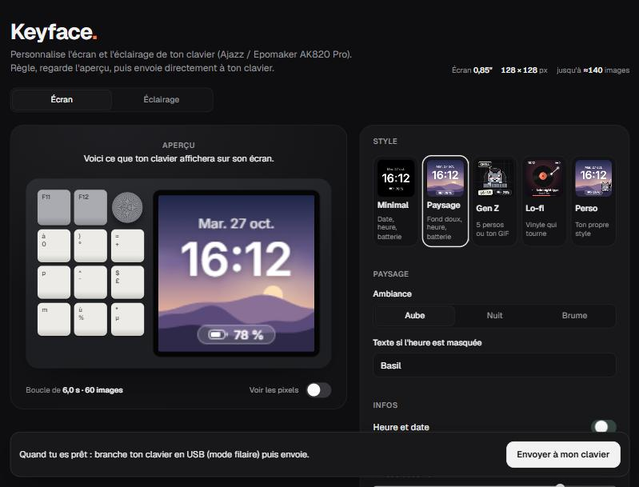
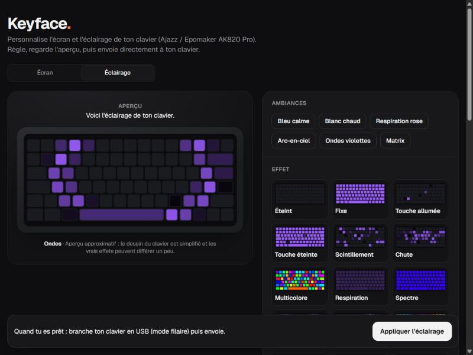

<div align="center">

# Keyface

**Make the tiny screen on your mechanical keyboard look good.**

Customise the **screen** and the **backlight** of your mechanical keyboard: ready-made animated styles, a drag-and-drop layer editor, 20 lighting effects with a live preview, and direct sending from the browser. Built for the **Ajazz / Epomaker AK820 Pro**, designed to grow to other keyboards. Free and open source.

[](https://github.com/forcela/keyface/actions/workflows/pages.yml)
[](LICENSE)

[**Open Keyface →**](https://forcela.github.io/keyface/)

[English](#english) · [Français](#français)




</div>

---

## English

### What it does

The AK820 Pro ships with a small 0.85" color screen (128 × 128 px) and a stock display most people find bland. Epomaker's official tool lets you upload your own animation, but you have to bring the frames yourself. Keyface makes those frames.

- **4 ready-made styles**
  - **Minimal**: date, big time, battery. Nothing else.
  - **Landscape**: soft wallpaper (dawn, night or mist) with drifting fog, the time and a glass battery pill.
  - **Gen Z**: five pixel mascots (cat typing, sleeping cat, cat with sunglasses, ghost, frog) on neutral palettes, or your own GIF.
  - **Lo-fi**: spinning vinyl record with a scrolling title.
- **Custom style editor**
  - Layers: background, effects (stars, snow, sparkles, grid, mist), time, date, battery, text, shapes, image or GIF, pixel mascots.
  - Drag layers on the live preview, resize from the corner, nudge with the arrow keys, snap to center, duplicate with Ctrl + D.
  - Per-layer settings: font, weight, size, color, soft shadow, opacity, battery style (pill, icon, ring, bar), corner radius, outline.
  - Per-layer animation that loops seamlessly: float, pulse, blink, sway, spin.
  - Start from a template (and undo it), auto-save in the browser, save and open styles as `.json`.
- **Backlight**: pick one of the 20 effects on animated cards (with a live preview on a drawing of the keyboard), a mood, a colour or rainbow, brightness, speed and direction, then apply it.
- **Send straight to your keyboard** from the page (Chrome or Edge, USB cable): connect it, click send, done. Also sets the keyboard's clock.
- **Export** every frame as a PNG in a `.zip`, ready for the official tool.
- Nothing to install, no account, no tracking. Everything runs locally in your browser.

The interface is in French for now. Translations are welcome, see [CONTRIBUTING.md](CONTRIBUTING.md).

### Send it to your keyboard directly

Use Chrome or Edge on a computer. Plug the keyboard in **with the USB cable**, switch it to **wired mode**, open the **Ton clavier** panel, click **Connecter mon clavier** and select **all** its entries in the browser's window. When it shows **Prêt**, click **Envoyer à l'écran** and keep the cable plugged until it is done.

**Status: beta.** The sequence comes from a project confirmed on real hardware, but this page has not been tried on a real keyboard yet. Reports are welcome: open an issue with the diagnostic from **Avancé → Copier le diagnostic**.

**Safety.** The page only writes the screen image and the keyboard's clock. It never touches keys, layout or lighting, and a test enforces that only the screen and clock commands can be sent. It refuses any keyboard it does not recognise as an AK820 Pro. The USB ids are the same for every layout, so the page cannot tell ISO from ANSI: the sequence was confirmed on an ISO model by the reference project, and ANSI models are untested here. If the screen does not change, try **Avancé → Variante B**, and unplug and replug the cable.

### Or use the official tool

1. In Keyface, pick or build a style and click **Exporter les images (.zip)**. Unzip it: you get `frame_000.png`, `frame_001.png`, …
2. Connect the keyboard **with the USB cable** and set its switch to **wired mode**.
3. Open Epomaker's official tool for your model. For the ISO versions it is a **web page** that needs Chrome or Edge on a computer, for example [ajazz.driveall.cn](https://ajazz.driveall.cn/#/). Click **Ajouter un nouvel appareil** to pick your keyboard. For the ANSI version, Epomaker offers a [Windows application](https://epomaker.com/blogs/software/ajazz-ak820-pro-driver).
4. In the tool, go to the screen (TFT) section, import **all the frames at once** and send them to the keyboard.
5. **Fn + Delete** switches the screen between the stock clock and your animation.

Button names differ between the tools and their versions, and the maintainers could not test every model. Black screen after upload? Try again with fewer frames (24 to 48).

### Limits worth knowing

- **No live data.** The keyboard stores the animation and plays it in a loop. The PC cannot push live content, so the time and battery drawn in a style are frozen at export time. For the real time, use the keyboard's own clock page (the official tool has a time sync option). Caps Lock and connection state are only shown on that page, for the same reason.
- About 140 frames max, 2 to 510 ms per frame (community findings, not an official spec).
- GIF import uses the browser's `ImageDecoder` (tested in Chromium browsers). Where it is missing, a GIF loads as a still image.

### Develop

Angular 22, TypeScript (strict), Tailwind CSS 4, Vitest. Package manager: pnpm.

```bash
git clone https://github.com/forcela/keyface.git
cd keyface
pnpm install
pnpm start          # http://localhost:4200
```

| Command | What it does |
| --- | --- |
| `pnpm start` | Dev server with live reload |
| `pnpm test` | Unit tests with coverage (fails under 70 % lines in `core`) |
| `pnpm lint` | ESLint, Angular rules |
| `pnpm build` | Production build in `dist/keyface/browser` |
| `pnpm check` | Tests, lint and build, as the CI runs them |

Every push to `main` is tested and deployed to GitHub Pages by [`.github/workflows/pages.yml`](.github/workflows/pages.yml). In the repository settings, set **Pages → Source** to **GitHub Actions** once.

### Project structure

```
src/app/
  core/                 no UI here
    render/             pure drawing code, no Angular: canvas helpers, sprites, scenery,
                        effects, battery widget, layer model and renderer, one file per style
    state/              signal stores: StudioStore (style, loop) and EditorStore (layers)
    rendering/          one shared animation clock and the frame renderer
    export/             PNG and zip export
    media/              GIF and image decoding
    style-file/         save and load styles as JSON, validating untrusted input
  features/
    stage/              keyboard mock-up, live preview, selection on the preview
    settings/           style picker, per-style settings, info, export
    editor/             templates, layer list, layer settings, style files
    help/               install steps
  shared/
    ui/                 small reusable components (segmented control, switch, range, color…)
    utils/
src/testing/            test helpers (a recording canvas context)
```

The rendering code in `core/render` takes a canvas context and a time `t` in [0, 1) and draws one frame. It knows nothing about Angular, so it can be tested and reused anywhere.

### Style file format

A saved style is JSON. Layers are drawn in order, the first one at the back. `x` and `y` are the layer's center in screen pixels. Images are embedded as data URLs.

```json
{
  "app": "keyface",
  "version": 1,
  "width": 128,
  "height": 128,
  "frames": 48,
  "delay": 80,
  "layers": [
    { "type": "background", "visible": true, "mode": "scenery", "ambiance": "dawn" },
    { "type": "time", "visible": true, "x": 64, "y": 52, "size": 38, "font": "inter", "weight": 600, "color": "#ffffff", "animation": "none" },
    { "type": "battery", "visible": true, "x": 64, "y": 113, "style": "pill", "color": "#ffffff", "scale": 1 }
  ]
}
```

Fields that are missing take their default. Unknown types and values are dropped, so a hand-edited file can not break the page.

### VIA keyboards (read only)

**Détecter un autre clavier** also lists keyboards that announce the open HID LampArray lighting standard (Windows "Dynamic Lighting"); those are only detected, nothing is read from or sent to them. For VIA keyboards, it reads what a QMK/VIA keyboard (Keychron, many Akko and custom boards) announces: VIA protocol version, number of key layers, firmware version, and which lighting channels answer. It sends four kinds of "get" requests and **writes nothing**: the code refuses to build any other request, and a test pins that. Controlling a VIA keyboard (colours, keys) needs a profile for its model and is not done yet. Vial keyboards use a different command set and are not covered.

### How other keyboards will be added

Each keyboard is described by a **profile** (`src/app/core/device/keyboard-profiles.ts`): its USB ids, what it can do (backlight with its effects, screen with its size) and how well that is established. The page recognises a connected keyboard from its profile and only shows what it can do. **A keyboard with no profile is never written to.** A keyboard family that speaks a different protocol needs its own driver next to `ak820-session.ts`. A keyboard cannot report "I have RGB" or "I have a screen" over USB, so models have to be added one by one, from observations on real hardware.

### Roadmap

The research behind this order (what is a real standard, what is not, what is verified) is in [docs/PLAN.md](docs/PLAN.md).

- [ ] Drive VIA keyboards (lighting first), once a model has been verified on real hardware
- [ ] Standby timer and per-key colours from the page
- [ ] English interface
- [ ] Other screen sizes and other keyboards with a TFT screen
- [ ] Animated GIF export
- [ ] Style gallery shared by the community

Ideas and pull requests are welcome, see [CONTRIBUTING.md](CONTRIBUTING.md).

### Credits

The screen specs and the upload sequence (128 × 128, RGB565, packets, frame limits) come from community projects that reverse-engineered the keyboard. The direct upload follows the sequence documented by [kabelklaus/ajazz-ak820-pro](https://github.com/kabelklaus/ajazz-ak820-pro) (MIT), a WebHID tool confirmed on real hardware; the code here is an independent TypeScript implementation. Other sources:
[open-ak820-pro](https://github.com/anthonymolinam/open-ak820-pro),
[ak820-linux](https://github.com/hcristosm/ak820-linux),
[ak820pro-modder](https://github.com/wsclx/ak820pro-modder),
[ajazzctl](https://github.com/SpawW/ajazzctl).

Keyface is an independent project. It is not affiliated with or endorsed by Ajazz or Epomaker.

---

## Français

### C'est quoi ?

Le clavier **Ajazz / Epomaker AK820 Pro** a un petit écran couleur de 0,85" (128 × 128 px) dont l'affichage d'origine est assez triste. L'outil officiel d'Epomaker permet d'y mettre ta propre animation, mais il faut lui fournir les images. Keyface les fabrique pour toi, directement dans le navigateur.

- **4 styles prêts** : Minimal, Paysage, Gen Z (5 persos pixel ou ton GIF), Lo-fi.
- **Un éditeur Perso** : ajoute des calques (heure, date, batterie, texte, forme, image ou GIF, perso, effets), déplace-les à la souris, règle-les, anime-les, enregistre ton style en `.json`.
- **Export** de toutes les images en `.zip`, prêtes pour l'outil officiel.
- Rien à installer, pas de compte, rien n'est envoyé nulle part.

### Mettre l'animation sur le clavier

1. Exporte le `.zip` depuis Keyface et décompresse-le.
2. Branche le clavier **en câble USB**, interrupteur en **mode filaire**.
3. Ouvre l'outil officiel de ton modèle. Pour les versions ISO, c'est une **page web** (Chrome ou Edge sur ordinateur), par exemple [ajazz.driveall.cn](https://ajazz.driveall.cn/#/) : clique sur **Ajouter un nouvel appareil** et choisis ton clavier. Pour l'ANSI, Epomaker propose une [application Windows](https://epomaker.com/blogs/software/ajazz-ak820-pro-driver).
4. Dans l'outil, va dans la partie écran (TFT), importe **toutes les images d'un coup** et envoie-les au clavier.
5. **Fn + Suppr** bascule entre l'horloge d'origine et ton animation.

L'heure et la batterie dessinées dans l'animation sont figées au moment de l'export : le clavier ne reçoit pas de données en direct.

### Développer

```bash
pnpm install
pnpm start
```

Voir la section [Develop](#develop) pour les commandes et la structure du projet.

---

## License

[MIT](LICENSE) © 2026 forcela8
